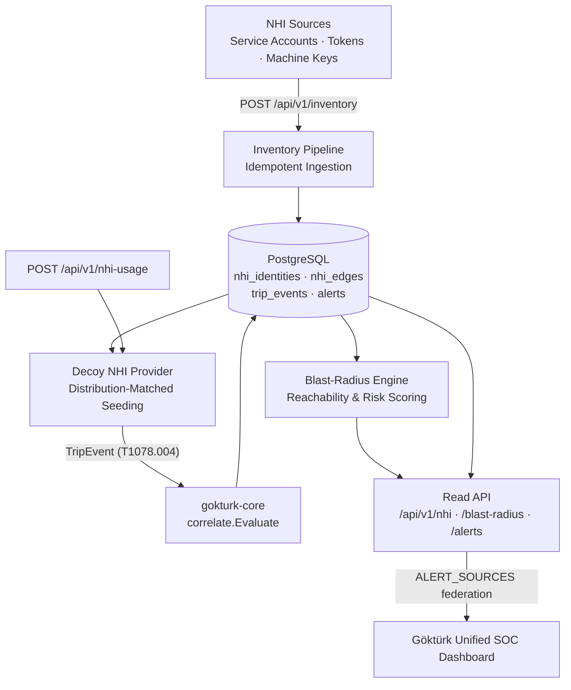

<div align="center">

# GÖKZİNCİR

**Non-Human Identity (NHI) Governance & Blast-Radius Graph (Göktürk Platform P3)**

[](https://go.dev/)
[](https://www.postgresql.org/)
[](https://github.com/GokturkFK/gokzincir)
[](docs/THREAT_MODEL.md)
[](https://github.com/GokturkFK)

*Inventory service accounts, tokens, and machine identities, map their true blast radius upon compromise, and seed indistinguishable decoy NHIs that trigger Critical zero-FP alerts the instant an attacker moves laterally.*

</div>

---

## Overview

**GÖKZİNCİR** is Pillar 3 (P3) of the Göktürk Security Platform. It combines **Non-Human Identity (NHI) visibility** with **active deception**:
- **Blast-Radius Graph:** Maps machine identities (`nhi_identities`) and permission/access relationships (`nhi_edges`) so security teams know exactly what a compromised service account can reach.
- **Stealth Decoy NHI Seeding:** Automatically plants realistic decoy identities (`DECOY_COUNT`, default `1`) **after** the initial inventory pass, sampling distributions from real inventory so decoys blend in seamlessly.
- **Zero-FP Detection:** Legitimate service-account usage generates zero noise; touching a decoy NHI triggers an instant `T1078.004` **Critical** alert via [`gokturk-core`](https://github.com/GokturkFK/gokturk-core), with repeat touches merged into a single campaign.

> **Stealth Guarantee:** Decoy IDs are **never** returned by any read API (`GET /api/v1/nhi` omits decoys and secret digests); they are logged exclusively to operator logs (`"msg":"sahte NHI ekildi"`), preserving indistinguishability even if an attacker inspects API responses.

---

## Architecture



---

## HTTP API

| Endpoint | Purpose |
| :--- | :--- |
| `GET /healthz` | Liveness / health check |
| `GET /api/v1/alerts` | Alerts feed — **identical wire contract** to GÖKTÜRK (P1) and GÖKKALKAN (P2) |
| `GET /api/v1/nhi` | NHI inventory (decoys and secret digests are strictly omitted) |
| `GET /api/v1/nhi/{id}/blast-radius` | Reachability graph & blast-radius score (visibility only, no alert) |
| `POST /api/v1/inventory` | Idempotent inventory ingestion round |
| `POST /api/v1/nhi-usage` | NHI usage observation; routes decoy touches into correlation |

### Connecting to the Unified Göktürk SOC Panel

No dashboard code changes are needed—simply add GÖKZİNCİR as a third alert source:

```sh
ALERT_SOURCES="GÖKTÜRK=http://control-api:8080,GÖKZİNCİR=http://host.docker.internal:8100"
```

---

## Quickstart & End-to-End Demo

```sh
cp deployments/docker/.env.example deployments/docker/.env
make docker-up          # in a separate terminal (Postgres :5434, NATS :4224/8224)
./scripts/demo.sh       # runs inventory -> blast-radius -> benign usage (0 alerts) -> decoy touch (Critical)
```

> Ports are offset from P1 (5432) and P2 (5433) so all three Göktürk pillars can run simultaneously on a single machine. Database migrations run automatically via the one-shot Compose `migrate` service (`goose_db_version`).

### Development & Testing

```sh
make build     # go build ./...
make test      # go test -race ./... (83.5% coverage in CI)
make lint      # golangci-lint
make vet
```

### Migrations

With Compose nothing manual is needed (the `migrate` service above). To run from the host, `goose` is required:

```sh
make migrate-up
make migrate-down
```

Both paths share the same version table (`goose_db_version`) and never double-apply. `00001_init.sql` intentionally contains only `trip_events` / `alerts` (identical to the `gokturk-core` schema); `00002_nhi.sql` adds the NHI/graph tables (`nhi_identities`, `nhi_edges`) after the Sprint 0 decision.

---

## v0.1 Definition of Done

| # | Item | Status |
| :---: | :--- | :--- |
| 1 | Inventory + relationship graph can be built | ✅ `scripts/demo.sh` step 1 |
| 2 | Blast radius readable from the API | ✅ step 2 |
| 3 | Decoy NHI usage → alert in ≤5 s | ✅ step 4 (instant) |
| 4 | Legitimate NHI usage → no alert | ✅ step 3 |
| 5 | `go test -race` green, coverage ≥ 70% | ✅ 83.5% in CI |
| 6 | README + threat model + demo GIF | threat model ✅, GIF [#4](../../issues/4) |
| 7 | CI can block PRs | ✅ branch protection enabled |

## Branch & PR Rules

`main` is protected: no direct pushes, PR + green CI required, squash-only merges.

---

## Göktürk Security Platform

| Pillar | Repository | Focus |
| :---: | :--- | :--- |
| **Core** | [**`gokturk-core`**](https://github.com/GokturkFK/gokturk-core) | Frozen `trap` wire contract & deterministic `correlate` engine |
| **P1** | [**`gokturk-deception-mesh`**](https://github.com/GokturkFK/gokturk-deception-mesh) | Credential canaries, SSH sensor, NATS JetStream & unified SOC dashboard |
| **P2** | [**`gokkalkan`**](https://github.com/GokturkFK/gokkalkan) | Agentic AI runtime security — MCP egress proxy & agent honeypot |
| **P3** | **`gokzincir`** *(this repo)* | Non-Human Identity (NHI) governance & blast-radius graph |

---

<div align="center">
  <sub>Developed by <a href="https://github.com/GokturkFK">GokturkFK</a> · Security Kernel: <a href="https://github.com/fetihcakmak">@fetihcakmak</a> · Platform/DevOps: <a href="https://github.com/uzunkubra50">@uzunkubra50</a></sub>
</div>
